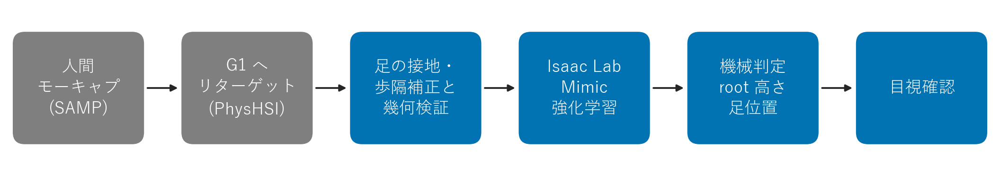

> 本ファイルは構成を説明するための骨組みである。報酬の重み・接触条件・終了条件の値・参照生成のパラメータは非公開(None のプレースホルダ)で、このままでは学習結果を再現できない。© 2026 okakei. All rights reserved.
> This file is a skeleton that describes the structure only. Reward weights, contact conditions, termination values and reference-generation parameters are withheld (None placeholders), so the learned results cannot be reproduced as is. © 2026 okakei. All rights reserved.

# g1-wheelchair-sit-stand

人型ロボットを車いすに座らせて人が押す運用が考えられますが、本研究で使用した制御構成(メーカー提供の歩行・立位制御)には車いすからの起立・着座が含まれていませんでした。現状は人がロボットを支えて立たせています。本研究では、介助なしでロボット自身がこの動作を行えるよう、Isaac Lab 上で市販の手動車いす(カタログ寸法を基に縮尺したメッシュ)からの起立・着座を、参照モーション模倣の強化学習(Mimic RL)で学習させました。ロボットは Unitree G1 EDU(29 自由度構成)で、シミュレーションには公式の 29 自由度モデル(g1_29dof)を使用しました。本リポジトリは、そのための自作部分のコード一式です。Stage 1 は車いすの前での起立・着座です。シミュレーション評価(各 N=10)で、着座方策と、開始区間の腕参照補助を併用した起立制御系が Stage 1 判定を各 10/10 で満たしました。腕込み判定はいずれも 0/10 です。Stage 2 は歩行を含む一連動作への拡張で、起立して前へ歩き去る退去は 10/10(厳格判定 9/10)、参照を修正し、後退相の足位置の追従と歩行相の両足同時離地の罰を加えて再学習した接近は、動作達成 10/10、厳格判定 9/10 です。

A humanoid could be moved by seating it in a wheelchair, but the controller configuration used in this work (the vendor's walking and standing control) did not include standing up from or sitting down onto one, so a person currently supports the robot to stand. In this work, a Unitree G1 EDU (29-dof configuration; simulated with the official g1_29dof model) was trained with imitation RL (Mimic) in Isaac Lab to do this on its own with a commercial manual wheelchair. In simulation (N=10 each), the sit policy and the stand control system (policy plus a reference arm assist in the starting window) met the Stage 1 criteria in 10/10 trials each; the arm-inclusive criteria were met in 0/10. In the walking extension, standing up and walking forward away was achieved in 10/10 (strict criteria 9/10), and approaching to sit with a corrected reference and additional gait penalties was achieved in 10/10 (strict criteria 9/10). Not achieved: the arm-inclusive criteria (both tasks, 0/10), hands resting on the thighs, removing the pelvis twist and arm asymmetry at the end of standing, standing without the arm assist, the strict approaching criteria in one of ten trials (9/10), and the strict departing criteria in one of ten trials (9/10). This repository contains only the original parts (mesh generation, motion correction, task skeleton, scripts).

## できていないこと(未達事項)

- 腕込み判定は着座・起立とも 0/10(着座は手首の高さ 0.663〜0.666 m、起立は肘掛け近似箱 −6.6〜−8.0 mm と手首の高さ 0.660〜0.664 m が未達)。
- 座位の手は腿の上方約 5 cm に留まり、腿に届かなかった(手首 z 0.660〜0.666 m、腿の上面 ≈ 0.60 m)。
- 起立の終端で骨盤が +8.5〜+12.4° 回り(腰ヨー −7.2〜−5.8°)、腕の回転も左右非対称(手首ロールの左右差 7.7〜11.8°)。
- 起立の開始座位の腕は参照補助(混合率 0.7)に依存し、補助なしでは腕を前に伸ばした。
- 歩いて接近し着座する動作は動作 10/10、厳格判定 9/10(1 回は終端の骨盤の誤差 3.9 cm)。斜め進入・正面接近・小刻み後退の 3 版は未達。
- 接近の歩行相の歩容: 初回の採用候補では歩行相の 7〜12% のフレームで両足が同時に離地し、採用方策では 0% になり骨盤高さも 0.75 m(参照 0.766 m、上下幅 0.04〜0.05 m)に近づいたが、歩幅 0.14〜0.18 m は参照 0.383 m の半分以下で小刻みな歩容が残る。原因は未切り分けで、既存の歩行制御から転回直前に切り替える構成か、実機の歩行記録を参照に使う方法が今後の課題。
- 退去は動作 10/10、厳格判定 9/10(1 回は起立途中の向きのずれが 32.7° で 30° を超えた)。
- 実機では検証していない。評価は各 N=10 のシミュレーションのみ。
- 補正なしの参照との同条件比較をしておらず、補正の寄与は分離していない。
- 同じ方策から補助だけを外した比較をしておらず、補助制御の寄与は分離していない。
- 評価時のシード設定は記録しておらず、同一条件での軌跡再現性は検証していない。

## 構成 / Layout

| パス | 内容 |
|---|---|
| `assets/` | 車いすメッシュ生成(`gen_wheelchair.py`)と USD 化の手順。市販の足板跳ね上げ型手動車いすの公開カタログ寸法(座面高 0.50 m など)から trimesh で座面・車輪・前脚・足板を手続き生成し、足板を跳ね上げた状態(95°)を Isaac Sim で USD に変換し、JIS T 9201:2016 に準拠する標準型の座面高 0.43 m に合わせるため 0.86 倍で配置した(規格への適合は認証していない)。物理の衝突は三角メッシュそのもので、車いすは質量・可動部のない固定の衝突体、足との距離の評価には同じ寸法の近似形状 40 個(`motions/chair_parts.json`)を使う |
| `motions/` | 参照モーションの出自、足接地・歩隔補正(`footclear.py`)、Stage 2 の整列・接地検出・逆再生(`stage2_motion.py`)、車いす衝突形状(`chair_parts.json`)、座位目標段階の参照生成(`formal_seat.py`)と式典座位の実測値(`formal_seat_pose.json`) |
| `tasks/` | Mimic タスク定義の骨組み(Stage 1、Stage 2、座位目標の導入段階)と座位目標段階の報酬・終了・補助制御(`formal_seat_mdp.py`)。報酬の重み・接触条件・調整値はプレースホルダ(非公開) |
| `scripts/` | クリーン再生+録画、root 高さの合否判定(Stage 1)、腕込みの合否判定(`eval_formal_seat.py`)、歩行込みの合否判定(`eval_stage2.py`) |
| `docs/` | 全体のパイプライン図(`fig1_pipeline.png`)、レポートと動画は別途提出(下記) |

## パイプライン / Pipeline

## 環境 / Environment

- Isaac Sim 5.1
- Isaac Lab 2.3
- unitree_rl_lab: commit `4960b84`(BSD-3、本リポジトリには同梱しない。各自 clone して使う)
- 参照モーション: PhysHSI のデータセットを各自取得する(`motions/README.md` 参照。データは同梱しない)
- Python: `numpy`, `trimesh`(メッシュ生成・モーション補正)

## 構成と利用範囲 / Scope

本リポジトリは構成の説明のための骨組みです。学習結果を再現するための値(報酬の重み、接触条件、参照生成のパラメータ)と学習済み重みは含みません。骨組みの `W` / `P` はプレースホルダ(`None`)で、そのままでは動きません。以下は処理の接続例です。姿勢 JSON は null の雛形で、非公開のパラメータ・衝突形状・未同梱の実装を補わない限り、生成・検証は完了しません。

This repository is a skeleton that describes the structure of the work. It does not include the values needed to reproduce the trained results (reward weights, contact conditions, reference-generation parameters) or the trained weights. `W` / `P` in the skeletons are placeholders (`None`) and the code does not run as is. The steps below are an example of how the processing connects. The pose JSON is a template with null values, so generation and verification do not complete unless you supply the withheld parameters, the collision shapes and the unbundled implementations.

1. unitree_rl_lab を commit `4960b84` で clone し、Isaac Lab 2.3 環境にインストールする。
2. `python assets/gen_wheelchair.py` で車いすメッシュ(down/up 変種)を `assets/out/` に生成し、`assets/README.md` の手順で USD 化する。
3. PhysHSI の chair 系データから該当クリップを取得し、`motions/README.md` の手順で npz に変換する。
4. `python motions/footclear.py build ...` で足の接地・歩隔を補正し、`verify` で検証する。
5. `tasks/tracking_env_cfg_skeleton.py` を元に、段階ごとの追加項(`tasks/README.md` の報酬表)を加えて、unitree_rl_lab のタスクとして登録する。報酬の重みと接触条件はプレースホルダのままで、各自で設定する。
6. 学習は unitree_rl_lab の標準の学習スクリプトで行う(本リポジトリには起動スクリプトを含めない)。
7. `scripts/play_record.py` で再生・録画し、`scripts/eval_rootz.py` で root 高さの合否を判定する。

各手順の出力例と所要時間は本リポジトリに含めていない。レポートは講座の提出システム(omnicampus)に、動画は YouTube の限定公開で提出する。URL は提出時に記入する。

### 座位目標の導入段階(式典座位・自然な腕・補助制御)

着座の終端と起立の開始を、実測した式典座位(足裏接地・上体鉛直・手は腿の上)を目標として置く段階です。結果では手は腿の上方に留まり、腿との接触は達成しませんでした。上の 1〜4 までは共通で、5 以降を次に置き換えます。

1. `python motions/formal_seat.py --sit <補正済み着座>.npz --stand <補正済み起立>.npz --urdf g1_29dof_rev_1_0.urdf --out-dir out/` で、式典座位に終わる着座(540 frame)と始まる起立(490 frame)の参照を作る。式典座位は `motions/formal_seat_pose.json`(雛形、値は null)。腕は体側 <-> 式典座位の間を補間し、人の腕の動きは一部だけ重ねる(前へ伸ばしたままにしない)。
2. `tasks/tracking_env_cfg_formal_seat_skeleton.py` と `tasks/formal_seat_mdp.py` を元に、着座・起立の 2 タスクを登録する(gym id は骨組みの docstring)。報酬の重みはプレースホルダ(非公開)。
3. 起立は環境変数 `ARM_PD_BLEND=0.7` を付けて学習・再生する(補助制御)。開始窓 [0, 100) frame で腕 14 関節の PD 目標を 0.3 × 方策 + 0.7 × 参照角にする。着座は補助なし。
4. 前の段階の方策から再開して学習し、`scripts/play_record.py` で再生し、軌跡を CSV(列は `scripts/eval_formal_seat.py` の冒頭に記載)に書き出して `python scripts/eval_formal_seat.py trace.csv sit`(起立は `stand`)で判定する。

補助制御ありの起立の結果は、模倣 RL 方策と開始座位の腕参照補助を組み合わせた制御系の性能です。方策単独による腕姿勢の獲得を示すものではありません。

### Stage 2(歩いて接近 -> 転回 -> 着座 / 起立 -> 前進 -> 退去(初期の試行は転回あり))

ここに置いたスクリプトは、人の参照どおりに斜めから進入する版のものです。この版は足の交差・転回位置・終端姿勢を含む厳格判定で 0/10 でした(結果の節)。

上の 1〜3 は共通。以降が Stage 2 の追加分。

1. PhysHSI の `chair_mo006`(SAMP 由来、接近約 1.0 m・転回約 132 度の着座)を取得し、Stage 1 と同じ手順で npz にする(`motions/README.md`)。
2. Stage 1 の立位クリップの先頭フレームから、座位基準の `anchor.json` を作る(`motions/README.md` の Stage 2 節)。
3. `python motions/stage2_motion.py --mode approach_sit ...` で着座の参照を作る。`--mode stand_depart` で逆再生した退去の参照を作る。レポート JSON の検証項目を確認する(しきい値は非公開)。
4. `tasks/tracking_env_cfg_stage2_skeleton.py`(報酬の重みはプレースホルダ)を元に、着座・起立の 2 タスク(gym id は `tasks/README.md`)を登録する。
5. Stage 1 の成功方策から再開して学習する(unitree_rl_lab の標準の学習スクリプト)。
6. `scripts/play_record.py` で再生・録画し、`python scripts/eval_stage2.py trace.csv motions/chair_parts.json approach_sit`(退去は `stand_depart`)で合否を判定する。

## 結果 / Results

評価は各 N=10(例外: Stage 2 の小刻み後退は学習途中の中間評価 5 回)、学習用の早期終了・初期化ノイズ・観測ノイズ・押しを無効にして判定した。摩擦の起動時ランダム化は評価でも無効化していない。評価時のシード設定は記録しておらず、同一条件での軌跡再現性は検証していない。反復数は累積で数え、採用方策は起立・採用と着座・採用。学習と評価は同一のシミュレーション環境で行い、学習は NVIDIA GeForce RTX 5080(16 GB)1 基、並列環境数(シミュレータ上で同時に実行するロボットの複製の数)は最大 4096。Stage 1 の採用方策は、先行試行の方策から累計で起立 5400 反復・約 2.9 時間、着座 5100 反復・約 2.5 時間(チェックポイントの保存時刻から算出)。報酬の座位窓(起立 [0,100)、着座 [390,540))と評価の窓(着座は最終 50 step、起立は開始座位 [0,50))は別。段階名はレポートと同じ。

| 段階 | Stage 1 判定 起立 / 着座 | 腕込み判定 起立 / 着座 | 腕込みの未達項目 | 主な変更 |
|---|---|---|---|---|
| 幾何補正 | 7/10 / 9/10 | - | - | 足の接地・歩隔・骨盤の補正(参照の足と全部材 1 cm 以上)、足と車いすの近接罰、各 1500 iter |
| 接触・外乱条件の追加 | 6/10 / 0/10 | - | - | 足首の後方移動、肘掛け・背もたれの近接罰、初期化ノイズと押し。着座は静止区間で前方へ滑り出して転倒 |
| 固定開始・位置追従の導入 | 9/10 / 10/10 | - | - | 車いす座標系の骨盤 xy 罰と、大きく外れた場合の終了、先頭からの固定開始、押しなし |
| 座位目標の導入 | 10/10 (補助あり) / 10/10 | 0/10 / 0/10 | 起立: 肘掛けの箱近似(−6.6〜−8.0 mm)と手首の高さ(0.660〜0.664 m)。着座: 手首の高さのみ(0.663〜0.666 m) | 実測した式典座位(足裏接地・膝内角 112°・手は腿の上)を着座の終端と起立の開始に置き、参照を左右対称化、腕を自然化。起立は開始座位の腕に参照補助を併用し、手首の目標を腿の上面より約 3 cm 上(旧目標より約 5 cm 上)へ修正・直立区間の腕中立と骨盤ヨーの罰を追加。着座 1500 + 500 + 600 iter、起立 1500 + 500 + 600 + 300 iter |

- 判定基準: 起立は最終 50 step 平均の root z ≥ 0.75 m かつ参照末尾との差 3 cm 以内、着座は root z 0.55〜0.68 m かつ座面中心から x, y とも ±0.10 m 以内。共通で、足と部材の距離が全 step で正、転倒なし(root z ≥ 0.4 m、骨盤傾き 60° 未満)、参照の完了、リセットなし。
- 腕込み判定(結果を見た後に追加): 座位窓で骨盤が式典座位から xy 3 cm・z 2 cm 以内、上体の傾きと腰ヨーが 5° 未満、肩の左右差 3 cm 未満、手首が高さ 0.62 m 未満で肘掛けの上にない、腕と肘掛けの箱近似の距離が正。
- 補助制御(起立のみ): 開始窓 [0, 100) frame で腕 14 関節の PD 目標を 0.3 × 方策 + 0.7 × 参照角とし、末尾 15 frame で smoothstep により解除。学習と再生の両方に適用。起立の結果は、模倣 RL 方策と開始座位の腕参照補助を組み合わせた制御系の性能であり、方策単独による腕姿勢の獲得を示すものではない。補助なしでは開始座位で腕を前に伸ばし、腕込み判定は 0/10 だった。
- 採用版の座位では、手は腿の上方に留まり、腿との接触は達成しなかった(手首 z 0.660〜0.666 m、腿の上面 ≈ 0.60 m で約 5 cm 上)。式典座位の「手は腿の上」は目標であり、結果ではない。
- 腕込みは両動作 0/10。着座は手首高さのみ、起立は肘掛け近似箱と手首高さが未達。旧目標と実際の手首位置に高さの差が生じた。腿との幾何干渉が一因と考えられるが、原因は切り分けていない。高さの閾値 0.62 m は旧目標から作った。起立は手首の目標を旧目標より上げ(腿の上面より上、値は非公開)+300 iter 学習したが未達。同じ修正を加えた着座は腰を下ろす瞬間に手首が弾かれ腕の角速度が 3.4〜10 rad/s に増えたため不採用で、着座の採用版は旧目標のまま。腕込み基準は初期結果の観察後に追加し、その後の比較では変更しなかった。ただし手首目標を修正した版では、手首の条件だけを修正後の目標から再定義した(z 0.657 m 未満、腿座標で目標から 3 cm 以内を窓の 95% 以上)。肘掛けの箱は保守的な近似で、物理接触は確認していない。
- 腕関節の最大角速度: 着座の採用版で 2.64 rad/s 以下。
- 参照の幾何: 補正なし d_min −1.59 / −1.61 cm、全補正 4.4 cm、立位保持の支持余裕 1.9→4.8 cm。
- 体格の制約: 下腿 0.32 m・座面 0.43 m のため、腿を水平にすると足裏が約 12 cm 浮き、足裏接地では膝内角 112° が限界(シミュレータ内で実測)。

座位目標の導入段階の版ごとの結果(提出に採用したのは着座・採用と起立・採用で、全基準に合格した版はない):

| 動作・モデル | 補助制御 | Stage 1 達成数/N | 腕込み達成数/N | 未達項目・実測値・閾値 | 限界 | 終端 骨盤ヨー / 腰ヨー / 左右足の横間隔 / 交差(事後) | 終端 腕の左右差 手首ロール / 肩ヨー(事後) |
|---|---|---|---|---|---|---|---|
| 着座・旧採用版 | なし | 9/10 | 9/10 | 1 回が浅座りで座面中心からのずれ 0.1003 m(閾値 0.10 m 以内)を超過 | 動作中は腕が前へ伸びたまま | −1.5〜+0.8° / −0.4〜+1.6° / 0.15〜0.22 m / なし | - |
| 着座・採用 | なし | 10/10 | 0/10 | 手首の高さ 0.663〜0.666 m(閾値 0.62 m 未満)のみ | 腿との幾何干渉が一因と考えられるが切り分けていない | −0.9〜+0.2° / −0.5〜+0.1° / 0.14〜0.18 m / なし | - |
| 起立・補助なし | なし | 10/10 | 0/10 | 手首の高さ 0.797〜0.831 m、肘掛け近似箱 −17〜−28 mm(閾値 0 超) | 開始座位で腕を前に伸ばす | +18〜+21° / −18〜−16° / 0.19〜0.23 m / なし | - |
| 起立・旧採用版 | 参照補助 70% | 10/10 | 0/10 | 手首の高さ 0.615〜0.634 m、肘掛け近似箱 −12〜−15 mm | 腕は補助に依存 | +14〜+21° / −17〜−14° / 0.17〜0.26 m / なし | - |
| 起立・自然化した腕(手首目標修正前) | 参照補助 70% | 10/10 | 0/10 | 肘掛け近似箱 −10〜−14 mm のみ | 腕は補助に依存 | +27〜+39° / −33〜−25° / 0.07〜0.19 m / なし | - |
| 起立・採用(手首目標修正、+300 iter) | 参照補助 70% | 10/10 | 0/10 | 肘掛け近似箱 −6.6〜−8.0 mm、手首の高さ 0.660〜0.664 m | 腕は補助に依存 | +8.5〜+12.4° / −7.2〜−5.8° / 0.13〜0.15 m / なし | 7.7〜11.8° / 1.7〜4.2° |
| 着座・手首目標修正版(不採用) | なし | 10/10 | 0/10 | 手首の高さ 0.662〜0.676 m のみ。腕の角速度 3.4〜10 rad/s、追加判定 7/10 | 腰を下ろす瞬間に手首が弾かれる | −0.7〜+12.4° / −7.6〜+0.2° / 0.10〜0.15 m / なし | - |

最終列は事後に追加した姿勢品質指標(最終 50 step 平均、合否には不使用)。骨盤ヨーは車いす正面からの骨盤の向き、腰ヨーは骨盤に対する上体の向き、横間隔は骨盤の向きに直交する方向の左右足首の距離。起立の終端では全回で骨盤がねじれ、上体だけが正面を向いていた。骨盤ヨーの罰などを追加した後に +27〜+39° から +8.5〜+12.4° に減ったが残り、腕の回転も左右非対称(手首ロールの左右差 7.7〜11.8°)だった。Stage 1 判定は直立姿勢の自然さまで保証しない。修正前は骨盤方向への直接の罰がなかった。採用版では追加したが、残存するねじれの原因は未検証。

### Stage 2(拡張)

| 動作 | 結果 | 内容 |
|---|---|---|
| 起立 -> 前へ歩き去る(前の版、追加学習前) | 動作達成 10/10、厳格判定 0/10 | 式典座位から起立し、転回せずに前へ歩いた(参照の歩行は約 1 m、実測の前進は約 1.6 m)。起立後の向きのずれが 32〜36° で厳格判定(30° 未満)を満たさなかった |
| 起立 -> 前へ歩き去る(採用、+250 反復) | 動作達成 10/10、厳格判定 9/10 | 前の版から +250 反復の候補(採用)と +1500 反復の候補(厳格 2/10)の 2 候補を N=10 で比較して選んだ。不合格の 1 回は起立途中の向きのずれ 32.7°。歩行相の上体傾き平均 7.5°、終端は座面中心から前方 1.87〜2.05 m、転倒・足の交差 0 |
| 接近 -> 着座(斜め進入) | 0/10 | 人の参照どおりの斜め進入で、脚が足板の支柱の間に斜めに入り、座面前縁に浅く腰掛けた |
| 接近 -> 着座(正面接近) | 0/10 | 足板の手前で 180° 転回して後ろ向きに入る振付。後退で足板の間に入れず、座面前縁からずり落ちた(2 回は転倒) |
| 接近 -> 着座(小刻み後退) | 中間評価で未達 | 転回の終わりに 5 回中 3 回転倒し、後退が届かなかった |
| 接近 -> 着座(参照修正版、前の採用候補) | 動作達成 5/10、厳格判定 4/10 | 参照を修正した(転回後半の中心、後退の歩数とテンポ、終端姿勢。生成パラメータは非公開)。報酬と開始フレームの抽選は変えず、既存方策から追加学習 |
| 接近 -> 着座(歩容の罰を加えた追加学習、採用方策) | 動作達成 10/10(転倒せず、終端の骨盤が座面上: 高さ 0.55〜0.68 m、座面中心から各軸 ±0.12 m。転倒 0 回)、厳格判定 9/10 | 前の採用候補から +754 反復。後退相の足位置の追従の罰を強め、歩行相に両足同時離地の罰を加えた(重みは非公開)。同じ追加学習の途中のチェックポイントを N=10 で事後に比較して採用。両足同時離地 0% |

厳格判定(結果を見た後に追加)は、接近で正面開始・転回 150° 以上・足板前端 x = 0.482 m より手前での転回・足の交差なし・終端の骨盤が式典座位から ±3 cm・上体 ±5°、退去で、起立区間より後の全フレームで向きのずれ 30° 未満、最終 50 step 平均の骨盤が座面中心から前方 1.2 m 以上、同じ平均の骨盤高さ 0.70 m 以上かつ参照末尾との差 5 cm 以内。退去の参照は、Stage 1 と同じ対称化・式典座位を用いた起立(490 フレーム)に、転回せず前へ歩き去る歩行を手続き的に接続して生成した(生成コードは未同梱)。採用版では、起立・腕を中立に戻す区間・前進 1.2 m の歩行を連結し(歩行は、公開データの前向き歩行の半歩を左右反転しながら連結し(生成パラメータは非公開)、足の接地点を固定して関節角を解き直した)、上体の傾きと骨盤高さの罰を加えて前の版から追加学習した。+250 反復と +1500 反復の 2 候補を N=10 で比較し、+250 反復の候補を採用した。学習を続けるほど起立時のねじれが増えた。退去の採用結果は既存の Stage 2 方策から追加学習した方策による。退去の報告値(動作 10/10、厳格 9/10)は、転回なしの直進退去用の評価器(向きのずれ 30° 未満、前方 1.2 m 以上、終端の骨盤高さ 0.70 m 以上。未同梱)で算出した。本リポジトリの `scripts/eval_stage2.py` は転回を伴う初期の試行用(転回 100° 以上を要求)で、この報告値は再現しない。接近の報告値(動作達成 10/10、厳格判定 9/10)も、接近の厳格判定を含む評価器(未同梱)で算出した。

本リポジトリ: https://github.com/robok-labs/g1-wheelchair-sit-stand 。レポートは講座の提出システム(omnicampus)に、動画は YouTube の限定公開で提出する(動画の URL は提出時に記入する)。

## 非公開部分 / Not included

- 学習済み重み(`.pt`)
- PhysHSI 由来のモーションデータおよびその派生データ(`.csv` / `.npz`)
- USD、動画、画像などの大容量ファイル(`.gitignore` で除外)

## 権利・利用条件 / Rights

© 2026 okakei. All rights reserved. 本リポジトリは課題提出のための閲覧用に公開する。閲覧以外の利用(複製・改変・再配布・商用利用・学習データとしての利用)は許可しない。ライセンスは付与しない。

© 2026 okakei. All rights reserved. This repository is published for viewing only, as part of a course assignment. Use other than viewing, including copying, modification, redistribution, commercial use and use as training data, is not allowed. No license is granted.

第三者データ(PhysHSI 等)とメーカー提供モデルの権利は各権利者に帰属する。
unitree_rl_lab と PhysHSI は参照のみで、そのコードやデータは本リポジトリに含まれない。

Rights to third-party data (such as PhysHSI) and to the manufacturer-provided model belong to their respective owners.
unitree_rl_lab and PhysHSI are referenced only; none of their code or data is bundled.
